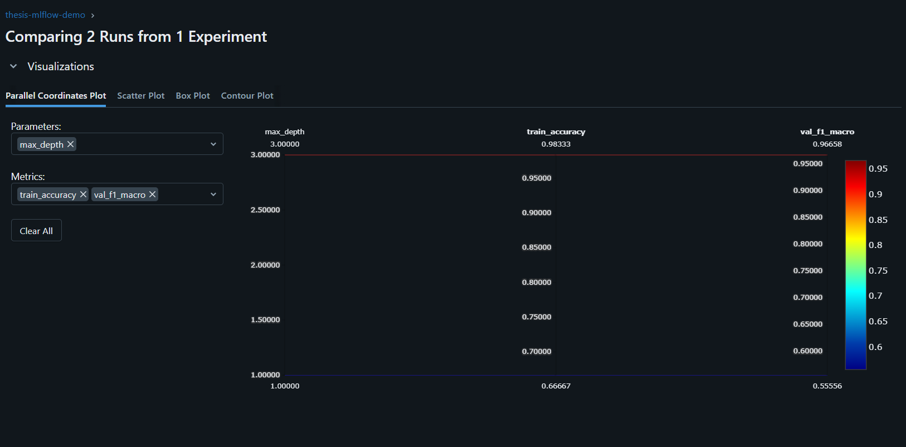
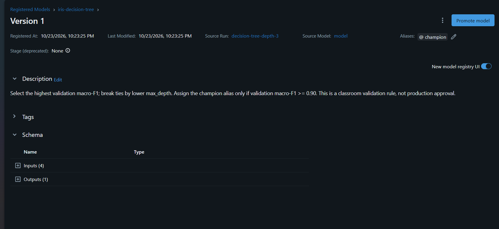

# MLflow Experiment Tracking and Model Registry

This project predicts Iris flower species from four measurements using a Decision Tree classifier. It compares two hyperparameter settings, logs training results with MLflow, registers the winning model, and reproduces its configuration from a previous run.

## Dataset

- Dataset: Iris, by R. A. Fisher.
- Source: https://archive.ics.uci.edu/dataset/53/iris
- DOI: https://doi.org/10.24432/C56C76
- Dataset license: Creative Commons Attribution 4.0 International (CC BY 4.0).
- Loader: `sklearn.datasets.load_iris(as_frame=True)`.
- Version used: the bundled dataset in scikit-learn 1.9.1.
- Size: 150 observations, four numeric features, three classes.
- Features: sepal length, sepal width, petal length, and petal width.
- Target: setosa, versicolor, or virginica.

The exact dataset used by each run is saved as `data/iris.csv`. Its SHA-256 hash and split indices are recorded in `dataset_metadata.json`.

Dataset SHA-256:

```text
0ba79ae755c686ee02dfe1d2943772a46ded2433c4fde6dd7ad3b01c41ff5d3d
```

## Setup

Create a virtual environment using the Python version recorded in the model's `python_env.yaml`. The following commands are for Windows PowerShell:

```powershell
python -m venv .venv
.\.venv\Scripts\Activate.ps1
python -m pip install -r requirements.txt
```

Dependency versions are pinned in `requirements.txt`.

## Tracking configuration

The script uses a local SQLite database named `mlflow.db` in the project directory. It constructs an absolute SQLite URI for both Tracking and the Model Registry.

From the project directory, the equivalent relative URI is:

```text
sqlite:///mlflow.db
```

Experiment name:

```text
thesis-mlflow-demo
```

Start the Tracking UI from the project directory:

```powershell
mlflow ui --backend-store-uri sqlite:///mlflow.db --port 5000
```

Open http://127.0.0.1:5000 and select the experiment under Training runs.

## Train and compare

```powershell
python train.py
```

This trains two Decision Tree classifiers with `max_depth=1` and `max_depth=3`.

Both runs use:

- The same dataset and feature columns.
- An 80% training / 20% validation split: 120 training and 30 validation rows.
- Stratified sampling.
- `random_state=42` for splitting and training.
- No scaling, because Decision Tree models do not require feature scaling.

The validation set is used for model selection. It is not an independent final test set.

## Logged information

Each run records:

- Parameters: model family, maximum depth, random seed, split settings, dataset hash, preprocessing, and scikit-learn version.
- Metrics: training and validation accuracy and macro-F1, row counts, tree depth, and leaf count.
- Artifacts: confusion matrix, validation predictions, configuration, dataset metadata, dataset CSV, source script, and requirements.
- Tags: Git commit and working-tree status, when available.

The selected run also receives the exported comparison and winner report.

## Results

| max_depth | Training macro-F1 | Validation accuracy | Validation macro-F1 |
| --- | --- | --- | --- |
| 1 | 0.555556 | 0.666667 | 0.555556 |
| 3 | 0.983323 | 0.966667 | 0.966583 |

The depth-3 model wins because its validation macro-F1 is higher. It has five leaves instead of two, but the improvement justifies the additional complexity in this small experiment.

Original run IDs:

- Depth 1: `82e8f2617d2a4db8814448309c8bb650`
- Depth 3: `86e3cc1740f54f69a1c241150a6fdc9b`

The comparison is exported to `reports/comparison.csv`. Selection details are saved in `reports/winner.json`.



## Model Registry

The winning model was registered with:

- Name: `iris-decision-tree`
- Version: `1`
- Alias: `champion`
- Source run: `86e3cc1740f54f69a1c241150a6fdc9b`

Promotion rule: select the model with the highest validation macro-F1, using lower maximum depth to break ties. Assign the `champion` alias only when validation macro-F1 is at least 0.90. This is a classroom validation rule, not production approval.

Running the comparison again creates a new registered version. If the winner meets the threshold, the alias points to that version.



## Reproduce the winning run

### Recover logged parameters

Run this command from the project directory while the virtual environment is active:

```powershell
python -c "import mlflow; mlflow.set_tracking_uri('sqlite:///mlflow.db'); run = mlflow.get_run('86e3cc1740f54f69a1c241150a6fdc9b'); print(run.data.params); print(run.data.tags)"
```

### Re-train from the original run

```powershell
python train.py --config-from-run 86e3cc1740f54f69a1c241150a6fdc9b
```

The script recovers maximum depth, random seed, and validation size from the run. It checks the dataset hash and scikit-learn version, trains a new model, and compares its validation accuracy and macro-F1 with the original values.

Verified reproduction run:

```text
db27b7baa0b241bd8954c5902e25905b
```

Observed result:

```text
Reproduction successful: validation metrics match.
```

The reproduction run also records the original run ID in its `reproduced_from_run_id` tag.

### Source revision

The original winning run was created before the first Git commit. It therefore has no committed revision and records an uncommitted-source note. The source script and requirements used for the run are preserved as MLflow artifacts.

For subsequent runs, the script records the Git commit and whether the working tree is clean or dirty.

### Reproduce after cloning

The original run IDs belong to the original local database. The database and model artifacts are excluded from Git.

After cloning, first run:

```powershell
python train.py
```

This creates a new local experiment, comparison, and registered model. Then reproduce the new winner using its generated run ID:

```powershell
$winner = Get-Content reports/winner.json -Raw | ConvertFrom-Json
python train.py --config-from-run $winner.run_id
```

## Secrets and generated files

No API keys or passwords are required.

The `.gitignore` excludes virtual environments, `.env` files, credentials, secrets, the local MLflow database, and local MLflow artifact directories.

Comparison reports and evidence screenshots are included in Git. Keep the original local database and artifact directories together to retain access to the original runs and model versions.